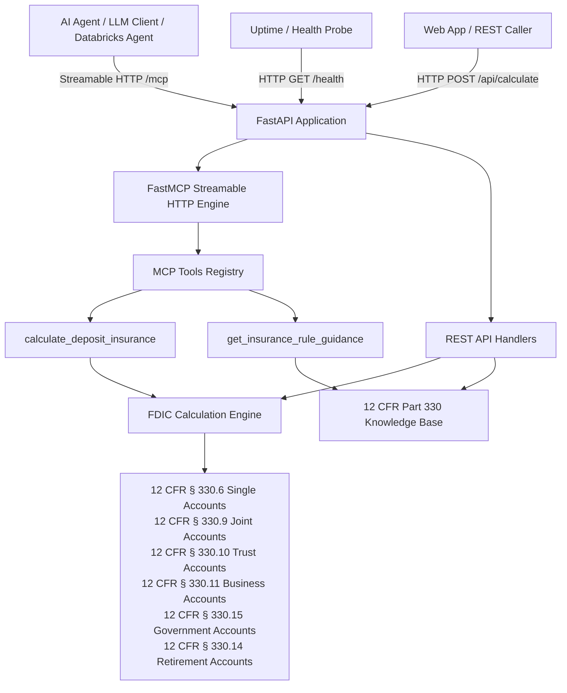

# FDIC Deposit Insurance Model Context Protocol (MCP) Server

[](https://www.gsa.gov/super-intelligence/si-community-of-practice/events-and-training/mcp-server-and-si-agent-government-hackathon)
[](https://modelcontextprotocol.io)
[](https://docs.databricks.com/en/dev-tools/databricks-apps/index.html)
[](https://www.ecfr.gov/current/title-12/chapter-III/subchapter-B/part-330)
[](https://www.python.org/)

Production-grade Model Context Protocol (MCP) server that interfaces with Federal Deposit Insurance Corporation (FDIC) deposit insurance regulations and calculations to replace traditional manual calculator lookups (such as [FDIC EDIE](https://edie.fdic.gov/)).

Built for the **GSA MCP Server and SI Agent Government Hackathon** and optimized for zero-configuration container deployment on **Databricks Apps**.

> [!IMPORTANT]
> **Disclaimer**: This project is developed independently using publicly available regulations, documentation, and tools (including 12 CFR Part 330 and the FDIC Financial Institution Employee's Guide). This is **not** an official FDIC tool, software, or Model Context Protocol (MCP) server, and is not affiliated with, sponsored by, or endorsed by the Federal Deposit Insurance Corporation (FDIC) or the U.S. Government.

---

## 🏛️ Regulatory Authority & Compliance

The calculation engine implements deposit insurance rules sourced directly from:
- **12 CFR Part 330** (Deposit Insurance Regulations)
- **FDIC Financial Institution Employee’s Guide to Deposit Insurance**
- **FDIC Trust Rule Simplification (Effective April 1, 2024)**: Merged revocable and irrevocable trusts under 12 CFR § 330.10, establishing a unified formula capped at 5 eligible beneficiaries per grantor (\$1,250,000 maximum per grantor per insured institution).
- **Public Unit Deposit Regulations (12 CFR § 330.15)**: Distinct bifurcated treatment for in-state institutions (separate \$250,000 pools for demand deposits vs. time/savings deposits, enabling up to \$500,000 per official custodian) vs. out-of-state institutions (\$250,000 aggregate cap).

---

## 🚀 Key Features

- **Pydantic v2 Validation**: Strict schemas for ownership categories (`single`, `joint`, `trust`, `business`, `government`, `retirement`), non-negative balances, and multi-owner configurations.
- **FastMCP Streamable HTTP Transport**: Exposes MCP tools over Streamable HTTP mounted at `/mcp`, interoperable with both stateful MCP clients and stateless JSON-RPC callers.
- **Databricks Apps Compatibility**: Dynamic port resolution via the `DATABRICKS_APP_PORT` environment variable (default: `8000`), container-ready host binding `0.0.0.0`, and companion `app.yaml`.
- **Dual API Interfaces**:
  - **MCP Tools**: `calculate_deposit_insurance` and `get_insurance_rule_guidance` for AI agents.
  - **REST Endpoints**: `/api/calculate`, `/api/guidance`, `/health`, and Swagger `/docs` for traditional web dashboards and monitoring probes.
- **Actionable Optimization Guidance**: Computes exact insured and uninsured amounts, and generates actionable restructuring advice (e.g., establishing POD trusts, ICS reciprocal networks, or collateralized public deposit protection).

---

## 📐 System Architecture



---

## 🛠️ MCP Tools Overview

### 1. `calculate_deposit_insurance`
Evaluates a list of deposit accounts and returns full portfolio totals, bank breakdowns, statutory category breakdowns, individual account allocations, and optimization recommendations.

**Input Parameters (`AccountInput`):**
| Field | Type | Description |
|---|---|---|
| `account_id` | `string` | Unique identifier (e.g., `"ACC-001"`) |
| `account_name` | `string` | Human-readable label (e.g., `"Primary Checking"`) |
| `category` | `enum` | `"single"`, `"joint"`, `"trust"`, `"business"`, `"government"`, `"retirement"` |
| `balance` | `float` | Account ledger balance (must be `>= 0.0`) |
| `deposit_type` | `enum` | `"checking"`, `"savings"`, `"cd"`, `"money_market"` (default: `"checking"`) |
| `bank_name` | `string` | Insured institution name (default: `"Primary FDIC-Insured Institution"`) |
| `owners` | `list[str]` | Owner/grantor names (required for joint accounts with `>= 2` owners) |
| `beneficiaries`| `list[str]` | Beneficiary names for trust accounts (capped at 5 per grantor under 2024 rule) |
| `is_sole_proprietorship` | `bool` | If true, business account aggregates under owner's single accounts |
| `official_custodian` | `string` | Custodian with plenary custody for public unit accounts |
| `jurisdiction` | `enum` | `"in_state"` or `"out_of_state"` relative to depository institution |

### 2. `get_insurance_rule_guidance`
Returns official regulatory guidance, formulas, statutory citations, and common pitfalls for specific categories or topics.

**Parameters:**
- `category` *(optional)*: `"single"`, `"joint"`, `"trust"`, `"business"`, `"government"`, `"retirement"`
- `topic` *(optional)*: E.g., `"2024 trust rule"`, `"death grace period"`, `"merger grace period"`, `"uninsured investments"`, `"sole proprietorship"`

---

## 📦 Project Structure

```
.
├── app.yaml               # Databricks Apps application deployment manifest
├── requirements.txt       # Production dependencies
├── server.py              # Main FastMCP server and FastAPI application entrypoint
├── fdic_engine.py         # Calculation engine, Pydantic schemas & FDIC rule repository
├── local_test.py          # Standalone verification script (runs 5 test phases locally)
├── tests/
│   └── test_server.py     # Comprehensive pytest test suite (23 test cases)
└── README.md              # Project documentation and compliance guide
```

---

## 🧪 Local Testing & Parallel Verification with FDIC EDIE

### 1. Parallel Differential Testing (EDIE JS vs. Python MCP Server)
The repository includes a parallel differential testing harness that downloads and runs the actual calculation algorithms from [`https://edie.fdic.gov/javascript/edie.js`](https://edie.fdic.gov/javascript/edie.js) via Node.js in parallel with the Python MCP Server, ensuring **100% mathematical parity**:

```bash
# Run visual side-by-side comparison
python parallel_test_runner.py

# Run automated differential test suite
python -m pytest -v tests/test_parallel_edie.py
```

### 2. Full Regression Test Suite (37 Tests)
Run all 37 unit, integration, and parallel differential tests:
```bash
python -m pytest -v tests/
```

### 3. Run Standalone Local Verification Script
Run the built-in end-to-end verification script:
```bash
python local_test.py
```

Output:
```
======================================================================
 FDIC DEPOSIT INSURANCE MCP SERVER - LOCAL VERIFICATION
======================================================================
[Step 1/5] Testing Health Check Endpoint (/health)...
  --> Status: HEALTHY
  --> Service: fdic-deposit-insurance-mcp
  --> Port: 8000
  --> Tools Loaded: calculate_deposit_insurance, get_insurance_rule_guidance

[Step 2/5] Testing Root Discovery Endpoint (/)...
  --> Service: FDIC Deposit Insurance MCP Server
  --> Regulatory Compliance: 12 CFR Part 330, FDIC Financial Institution Employee's Guide...
  --> MCP Path: /mcp

[Step 3/5] Testing REST Calculation API (/api/calculate)...
  --> Total Portfolio Balance: $3,150,000.00
  --> Total Insured:           $2,750,000.00
  --> Total Uninsured:         $400,000.00
  --> Insurance Coverage:      87.3%

[Step 4/5] Testing MCP Streamable HTTP Transport (/mcp/ -> tools/list)...
  --> MCP Streamable HTTP Protocol Handshake: SUCCESS (HTTP 200)
  --> Discovered Tools: calculate_deposit_insurance, get_insurance_rule_guidance

[Step 5/5] Invoking calculate_deposit_insurance via MCP JSON-RPC Protocol...
  --> MCP Tool Call: SUCCESS
  --> 2024 FDIC Trust Rule Verification:
      Grantor Alice has 7 beneficiaries, capped at 5 ($1,250,000 maximum).
      Result correctly reports $1,250,000 Insured, $250,000 Uninsured.

======================================================================
 ALL LOCAL INTEGRATION TESTS COMPLETED SUCCESSFULLY (100% PASS)
======================================================================
```

### Step 4: Run the Live Server
Start the server locally:
```bash
python server.py
```
Open [http://localhost:8000/docs](http://localhost:8000/docs) in your browser to inspect interactive OpenAPI documentation.

---

## ☁️ Databricks Apps Deployment

This server is pre-configured for Databricks Apps using `app.yaml`:

```yaml
command:
  - "python"
  - "server.py"

env:
  - name: "PYTHONUNBUFFERED"
    value: "1"
  - name: "DATABRICKS_APP_PORT"
    value: "8000"
```

1. Deploy the folder directly to your Databricks Workspace under **Compute > Apps**.
2. Databricks Apps automatically assigns a port via `DATABRICKS_APP_PORT` and routes external traffic to the container.
3. Access the MCP endpoint at `https://<databricks-app-url>/mcp`.

---

## 📡 Sample MCP Invocations

### Example: Trust Account (April 1, 2024 Simplification Rule)
**Request Payload:**
```json
{
  "jsonrpc": "2.0",
  "id": 1,
  "method": "tools/call",
  "params": {
    "name": "calculate_deposit_insurance",
    "arguments": {
      "accounts": [
        {
          "account_id": "TRST-001",
          "account_name": "Smith Family Revocable Trust",
          "category": "trust",
          "balance": 1800000.0,
          "owners": ["John Smith", "Mary Smith"],
          "beneficiaries": ["Child A", "Child B", "Child C"]
        }
      ]
    }
  }
}
```

**Calculation Breakdown:**
- Number of Grantors: `2` (John Smith, Mary Smith)
- Eligible Beneficiaries: `3` (Child A, Child B, Child C)
- Maximum Coverage Limit: `2 grantors × 3 beneficiaries × $250,000 = $1,500,000`
- Balance: `$1,800,000.00`
- Insured Amount: `$1,500,000.00`
- Uninsured Balance: `$300,000.00`
- Recommendation: Restructure \$300,000 to another FDIC-insured institution to maintain 100% coverage.

---

## ⚖️ Legal & Government Open Source Compliance

- **Federal Source Code Policy**: Open-source public domain software designed for US Government inter-agency reuse.
- **Section 508 Accessibility**: Structured machine-readable JSON schemas and descriptive text outputs ensuring accessibility for assistive technology and conversational agents.
- **FDIC Statutory Notice**: Calculations are provided for educational and estimation purposes in accordance with 12 CFR Part 330. Actual insurance claims upon bank failure are resolved based on the official records of the failed institution.
